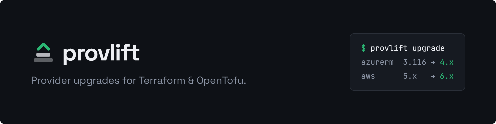

<p align="center">
  
</p>

# provlift

**Keep Terraform and OpenTofu providers current across every module — with
upgrades you can actually review.**

`provlift` inventories provider requirements, checks the registry for newer
versions, finds drift between modules, and prepares minimal, reviewable
provider upgrades. It edits version constraints in place and leaves lock-file
generation to Terraform or OpenTofu, so checksums are always correct.

[](https://github.com/provlift/provlift/actions/workflows/ci.yml)
[](LICENSE)

## Why

Keeping providers up to date across dozens of repositories and modules is
repetitive work that rarely gets prioritised until a major version is overdue.
General-purpose dependency bots such as Renovate and Dependabot can bump a
version string, but provider upgrades have Terraform-specific wrinkles they are
not designed to handle:

- **Dependency ceilings.** A constraint inside a shared module caps every
  consumer. `provlift` reads the downloaded module tree, never plans a version
  a dependency forbids, and names the module that is blocking the upgrade.
- **Constraint shapes.** `~> 6.0`, `>= 3.85.0`, `>= 3.0, < 4.0` and `= 3.1.0`
  each need a different rewrite — or none at all. `provlift` changes a
  constraint only when it blocks the target, and preserves the author's style.
- **Lock files.** `.terraform.lock.hcl` holds per-platform checksums that only
  Terraform or OpenTofu can compute. `provlift` runs `init -upgrade` and
  `providers lock` for every platform your team uses, so the lock works on
  Linux CI, macOS laptops and Windows workstations alike.
- **Root vs shared modules.** A root configuration moves its locked version; a
  shared module raises its supported floor. `provlift` knows the difference.

## Features

- **`list`** — offline inventory of every `required_providers` entry, with file
  and line.
- **`check`** — newest patch, minor and major per provider, with `BLOCKED`
  showing whether the local constraint or a dependency is in the way.
- **`drift`** — offline detection of version skew, constraint divergence and
  root modules without a lock file.
- **`upgrade`** — budgeted (`--level patch|minor|major`) or progressive
  (`--exact-level`, `--next-major`) upgrades; majors require `--allow-major`.
- **`validate`** — `fmt -check` and `validate` across every root module, with
  opt-in `plan`.
- **CI-ready** — stable JSON output, `--exit-code` gating, generated pull
  request titles, branches and bodies, and copy-paste GitHub Actions
  [workflow examples](https://github.com/provlift/provlift/tree/main/examples/workflows).
  The CLI never needs a forge token.
- **Safe edits** — byte-precise splices that keep comments and alignment,
  atomic writes with rollback, and stale-scan detection.

## Works with

- **Terraform** (default) and **OpenTofu** (`--terraform-binary tofu` or
  `terraform.binary: tofu`; bare provider sources then resolve to
  `registry.opentofu.org`).
- **Any provider in any registry** that speaks the provider registry protocol —
  the public Terraform registry, the OpenTofu registry, or a private registry.
  AWS, AzureRM, Google, GitHub, Kubernetes and every other provider are handled
  identically; there is no per-provider code.

## Install

```sh
go install github.com/provlift/provlift/cmd/provlift@latest
```

Prebuilt binaries for Linux, macOS and Windows are on the
[releases page](https://github.com/provlift/provlift/releases). See
[installation](docs/installation/README.md) for pinning, `PATH` setup and
building from source.

## Quick start

From the root of a Terraform or OpenTofu repository:

```sh
provlift list                          # what is declared, offline
provlift check                         # what the registry offers
provlift drift                         # where modules disagree, offline
provlift upgrade --level minor --dry-run
provlift upgrade --level minor         # edit constraints, regenerate locks
git diff                               # review, then open a pull request
```

Major upgrades require `--allow-major`. Continue with the
[quick start](docs/quick-start/README.md) and the
[CLI reference](docs/cli/README.md).

## Documentation

| Topic | Guide |
|---|---|
| Install and prerequisites | [Installation](docs/installation/README.md) |
| First-run sequence | [Quick start](docs/quick-start/README.md) |
| Commands, flags and exit codes | [CLI reference](docs/cli/README.md) |
| Version selection, constraints and lock files | [Upgrade behavior](docs/upgrade/README.md) |
| `.provlift.yaml` and OpenTofu | [Configuration](docs/configuration/README.md) |
| Private registry credentials | [Authentication](docs/authentication/README.md) |
| CI and pull-request automation | [CI/CD workflows](docs/ci-cd/README.md) |
| Errors and known limitations | [Troubleshooting](docs/troubleshooting/README.md) |
| Components and design | [Architecture](docs/architecture/README.md) |
| Tests and releases | [Development](docs/development/README.md) |
| Upstream Terraform and OpenTofu references | [Reference documentation](docs/reference/README.md) |

A searchable command overview is published at
[provlift.github.io/provlift](https://provlift.github.io/provlift/).

## Scope

`provlift` manages **provider** dependencies. It does not upgrade module
versions, change resources, or run `apply`.

## Contributing

Bug reports, feature requests and pull requests are welcome. Please read
[CONTRIBUTING.md](https://github.com/provlift/provlift/blob/main/CONTRIBUTING.md)
and the
[Code of Conduct](https://github.com/provlift/provlift/blob/main/CODE_OF_CONDUCT.md),
and report security issues privately as described in
[SECURITY.md](https://github.com/provlift/provlift/blob/main/SECURITY.md).
See the [changelog](CHANGELOG.md) for release history.

## License

`provlift` is licensed under the [Apache License 2.0](LICENSE).
