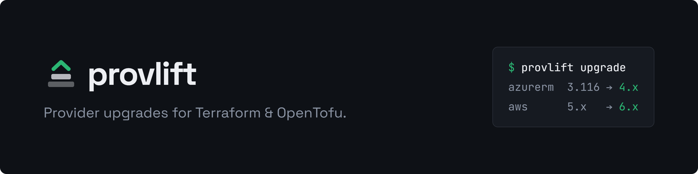
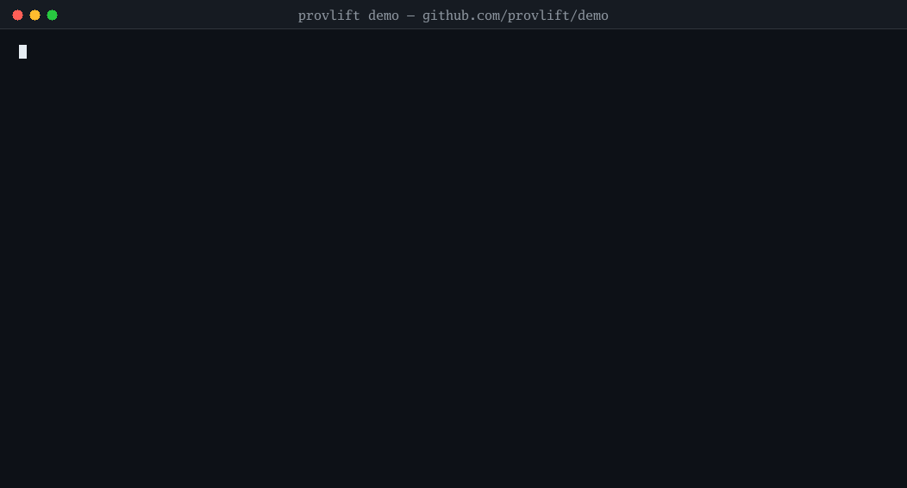

<p align="center">
  
</p>

# provlift

**Keep Terraform and OpenTofu providers current across every module — with
upgrades you can actually review.**

[](https://github.com/provlift/provlift/actions/workflows/ci.yml)
[](https://github.com/provlift/provlift/releases)
[](LICENSE)

<p align="center">
  <picture>
    <!-- Readers who ask for reduced motion get a still frame of the same demo. -->
    <source media="(prefers-reduced-motion: reduce)" srcset="brand/demo-still.png">
    
  </picture>
</p>

`provlift` finds every provider your modules declare, shows what is newer, and
upgrades them with the smallest constraint edits that work. Terraform or
OpenTofu then regenerates the lock files, so checksums are always correct.

## Install

```sh
go install github.com/provlift/provlift/cmd/provlift@latest
```

Or download a binary for Linux, macOS or Windows from the
[releases page](https://github.com/provlift/provlift/releases).

## Try it in two minutes

The [demo repository](https://github.com/provlift/demo) has providers
deliberately left behind, a shared module that caps an upgrade, and drift
between environments. It needs no cloud credentials, and provlift never runs
`apply`. It does need Terraform 1.6 or later on `PATH`, even if you normally
use OpenTofu, because its `envs/` roots run Terraform.

```sh
git clone https://github.com/provlift/demo.git provlift-demo && cd provlift-demo
./setup.sh                                   # or .\setup.ps1 on Windows
provlift check                               # what is behind, and what blocks it
provlift upgrade --level minor --provider github --provider random
git diff                                     # the whole change, ready to review
```

## Why not Renovate or Dependabot?

They can bump a version string, but provider upgrades have Terraform-specific
wrinkles they are not designed to handle:

- **Dependency ceilings.** A constraint inside a shared module caps every
  consumer. `provlift` reads local shared modules and the downloaded module
  tree, never plans a version a dependency forbids, and names the module that
  is blocking the upgrade.
- **Constraint shapes.** `~> 6.0`, `>= 3.85.0`, `>= 3.0, < 4.0` and `= 3.1.0`
  each need a different rewrite — or none at all. `provlift` changes a
  constraint only when it blocks the target, and preserves the author's style.
- **Lock files.** `.terraform.lock.hcl` holds per-platform checksums that only
  Terraform or OpenTofu can compute. `provlift` runs `init -upgrade` and
  `providers lock` for every platform your team uses, so the lock works on
  Linux CI, macOS laptops and Windows workstations alike.
- **Root vs shared modules.** A root configuration moves its locked version; a
  shared module raises its supported floor. `provlift` knows the difference.

## Features

- **`list`** — offline inventory of every `required_providers` entry, with file
  and line.
- **`check`** — newest patch, minor and major per provider, with `BLOCKED`
  showing whether the local constraint or a dependency is in the way.
- **`drift`** — offline detection of version skew, constraint divergence and
  root modules without a lock file.
- **`upgrade`** — budgeted (`--level patch|minor|major`) or progressive
  (`--exact-level`, `--next-major`) upgrades; majors require `--allow-major`.
- **`validate`** — `fmt -check` and `validate` across every root module, with
  opt-in `plan`.
- **CI-ready** — stable JSON output, `--exit-code` gating, generated pull
  request titles, branches and bodies, and copy-paste GitHub Actions
  [workflow examples](https://github.com/provlift/provlift/tree/main/examples/workflows).
  The CLI never needs a forge token.
- **Safe edits** — byte-precise splices that keep comments and alignment,
  atomic writes with rollback, and stale-scan detection.

## Works with

- **Terraform** (default) and **OpenTofu** (`--terraform-binary tofu` or
  `terraform.binary: tofu`; bare provider sources then resolve to
  `registry.opentofu.org`).
- **Any provider in any registry** that speaks the provider registry protocol —
  the public Terraform registry, the OpenTofu registry, or a private registry.
  AWS, AzureRM, Google, GitHub, Kubernetes and every other provider are handled
  identically; there is no per-provider code.

## Quick start

From the root of your own Terraform or OpenTofu repository:

```sh
provlift list                          # what is declared, offline
provlift check                         # what the registry offers
provlift drift                         # where modules disagree, offline
provlift upgrade --level minor --dry-run
provlift upgrade --level minor         # edit constraints, regenerate locks
git diff                               # review, then open a pull request
```

Major upgrades require `--allow-major`. Continue with the
[quick start](docs/quick-start/README.md) and the
[CLI reference](docs/cli/README.md). See
[installation](docs/installation/README.md) for pinning a version, `PATH` setup
and building from source.

## Documentation

| Topic | Guide |
|---|---|
| Install and prerequisites | [Installation](docs/installation/README.md) |
| First-run sequence | [Quick start](docs/quick-start/README.md) |
| Commands, flags and exit codes | [CLI reference](docs/cli/README.md) |
| Version selection, constraints and lock files | [Upgrade behavior](docs/upgrade/README.md) |
| `.provlift.yaml` and OpenTofu | [Configuration](docs/configuration/README.md) |
| Private registry credentials | [Authentication](docs/authentication/README.md) |
| CI and pull-request automation | [CI/CD workflows](docs/ci-cd/README.md) |
| Errors and known limitations | [Troubleshooting](docs/troubleshooting/README.md) |
| Components and design | [Architecture](docs/architecture/README.md) |
| Tests and releases | [Development](docs/development/README.md) |
| Upstream Terraform and OpenTofu references | [Reference documentation](docs/reference/README.md) |

A searchable command overview is published at
[provlift.github.io/provlift](https://provlift.github.io/provlift/).

## Scope

`provlift` manages **provider** dependencies. It does not upgrade module
versions, change resources, or run `apply`.

## Contributing

**Tried provlift?** Tell us how it went, including what worked, what broke and
what is missing, in the
[welcome discussion](https://github.com/provlift/provlift/discussions/9) or by
[opening an issue](https://github.com/provlift/provlift/issues/new/choose).
Reports from real repositories are the most useful feedback the project gets.

Bug reports, feature requests and pull requests are welcome. Please read
[CONTRIBUTING.md](https://github.com/provlift/provlift/blob/main/CONTRIBUTING.md)
and the
[Code of Conduct](https://github.com/provlift/provlift/blob/main/CODE_OF_CONDUCT.md),
and report security issues privately as described in
[SECURITY.md](https://github.com/provlift/provlift/blob/main/SECURITY.md).
See the [changelog](CHANGELOG.md) for release history.

## License

`provlift` is licensed under the [Apache License 2.0](LICENSE).
