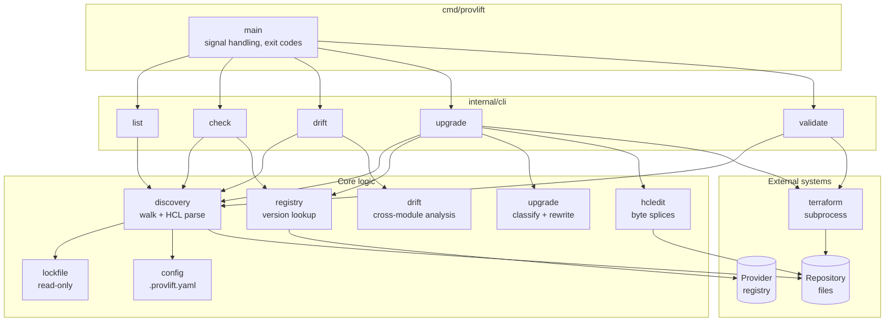
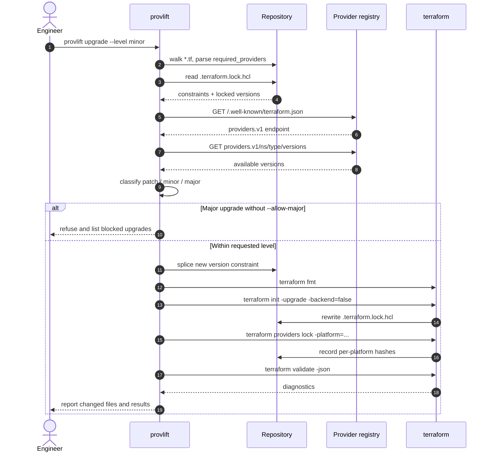
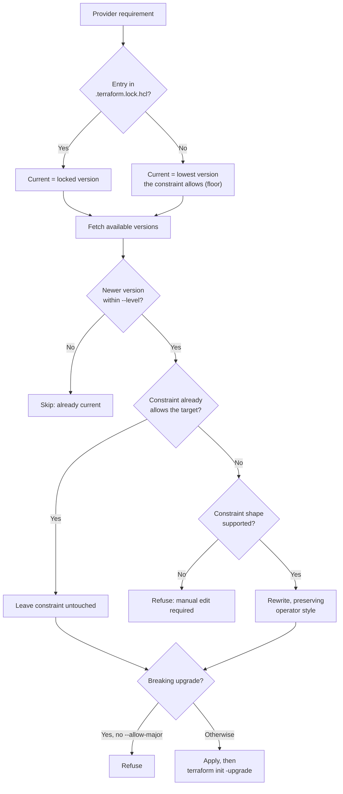

# provlift — Architecture

Reference for contributors working on `provlift`, and for anyone auditing whether the
tool does what it claims. Every statement here is meant to be verifiable against
the source or by running the CLI. Where behaviour is imperfect, it is written down
rather than smoothed over.

- **Module:** `github.com/provlift/provlift`
- **Binary:** `provlift`
- **Language:** Go (see `go.mod` for the pinned toolchain)
- **Scope:** Terraform/OpenTofu *provider* dependencies. Not module versions, not resources.

---

## 1. What problem this solves

Any team running Terraform or OpenTofu across more than a handful of modules
answers four questions badly by hand:

1. Which providers are in use, and at what versions?
2. What upgrades exist, and how risky is each one?
3. Do the modules agree with each other?
4. Can an upgrade be applied without breaking the lock file?

`provlift` answers all four mechanically, and turns the fourth into a reviewable
pull request.

## 2. Design invariants

These are the load-bearing rules. Breaking one is a behavioural regression, not a
refactor.

| # | Invariant | Enforced in |
|---|---|---|
| I1 | The tool never writes `.terraform.lock.hcl` directly. Terraform regenerates it. | `internal/terraform` |
| I2 | A version constraint is rewritten **only** when it would otherwise block the target version. | `internal/upgrade/constraint.go` |
| I3 | Edits are byte-range splices. Comments, alignment, and ordering survive untouched. | `internal/hcledit` |
| I4 | Ambiguous constraints are refused, never guessed. | `ErrUnsupportedConstraint` |
| I5 | Major and breaking changes require explicit `--allow-major`. | `internal/cli/upgrade.go` |
| I6 | Providers are identified by fully qualified address, never by local name. | `internal/model/address.go` |
| I7 | Every `upgrade --json` outcome, including dry runs, no-ops and errors, emits the same top-level keys; errors also exit nonzero and print `Error:` on stderr. | `internal/cli/upgrade.go` |
| I8 | A stale scan is detected and refused rather than applied blindly. | `discovery` file hash, `internal/hcledit` |

## 3. Package layout

```
cmd/provlift            Entry point, signal handling, exit codes
internal/cli          Cobra commands, table + JSON rendering, orchestration
internal/model        Provider addresses, modules, locks, module graph
internal/discovery    Repository walk, HCL parsing, root vs child detection
internal/lockfile     .terraform.lock.hcl reader (read-only)
internal/registry     Registry protocol client, service discovery, credentials
internal/upgrade      Classification, constraint rewriting, planning
internal/drift        Cross-module consistency analysis
internal/depgraph     Provider constraints declared by vendored modules
internal/hcledit      Byte-precise constraint edits (Terraform fmt can rewrite .tf later)
internal/terraform    Terraform subprocess execution ← only package that runs Terraform
internal/pullrequest  Branch name, title, labels, markdown body
internal/config       .provlift.yaml loading and policy
internal/report       Table and JSON output helpers
```

Two packages are privileged and deserve the most review attention:

- `internal/hcledit` — the direct constraint editor; `terraform fmt` can also rewrite `.tf` files.
- `internal/terraform` — the only executor of subprocesses.

## 4. Pipeline

```
discover → read locks → resolve versions → classify → plan → edit → terraform → report
```

1. **Discover** — walk the repo, parse `required_providers` with the HCL library
   (never regex). Skip `.git`, `.terraform`, `node_modules`, `.idea`, `.vscode`,
   `.terragrunt`, plus configured excludes. A directory referenced by another
   module's local `source = "./..."` is marked a **child**.
2. **Read locks** — parse `.terraform.lock.hcl` where present.
3. **Resolve versions** — registry protocol: service discovery at
   `/.well-known/terraform.json`, then `GET <providers.v1>/<ns>/<type>/versions`.
   Concurrent, cached per run, retried on 429/5xx. Sources without a hostname
   resolve to `registry.terraform.io`, or to `registry.opentofu.org` when the
   configured binary is OpenTofu (`tofu`).
4. **Classify** — patch / minor / major. `0.x` minor bumps are flagged breaking.
5. **Plan** — choose a target under the level budget, honouring dependency
   ceilings. Produces `Action` or a `Skip` with a human reason.
6. **Edit** — byte splices, applied back-to-front, atomic per file with rollback.
7. **Terraform** — `fmt` → `init -upgrade` → `providers lock -platform=...` → `validate`.
8. **Report** — table or stable JSON.

## 5. Domain concepts that trip people up

### Constraint vs locked version

Two distinct things, never conflated:

- **Constraint** (`required_providers`) — what is *acceptable*.
- **Locked version** (`.terraform.lock.hcl`) — what is *actually selected*.

### "Current version" depends on repository shape

| | Root configuration | Shared module |
|---|---|---|
| Lock file | Committed | Deliberately absent |
| "Current" means | The locked version | The **constraint floor** |
| Upgrading means | Move the locked version | Raise the tested floor |

Where a module has no lock file, the **lowest version the constraint admits** is
reported, suffixed `(floor)`. Using the highest allowed version instead would make
every shared module report "nothing to do", since the highest allowed version is
the newest by definition.

### Dependency ceilings

Constraints intersect across the whole module tree. A ceiling inside a consumed
module binds this repository even though nothing here declares it. Reported as
`BLOCKED = dep`, with the imposing modules named.

**This requires the module tree to be on disk.** On a fresh checkout the ceiling
is still respected but is misattributed to the local constraint (`BLOCKED = yes`)
because nothing has been vendored. Run `terraform get` first to get accurate
attribution. This is why `examples/workflows/provider-compatibility.yml` vendors
before checking.

### Upgrade level is a budget, not a step

`--level minor` means "patch **or** minor". `--exact-level` narrows it to exactly
that level, which is what makes progressive patch → minor → major staging work.
Each level budget selects the next published candidate. `--exact-level`
selects the next candidate at that specific level; `--next-major` selects the
first release in the next major series, skipping intervening patch/minor releases.

## 6. Security model

### What the tool handles

- **Registry tokens.** Read the way Terraform reads them: `TF_TOKEN_<host>` first,
  then `credentials.tfrc.json`, then the CLI config file. Sent only as a `Bearer`
  header, only to the host the token belongs to. Never logged, never in output.
- **No forge credentials.** The CLI never creates pull requests and holds no
  GitHub token. It emits PR *content*; CI raises the PR. This is deliberate.
- **Cloud credentials** are not needed for offline inventory or registry lookups.
  Opt-in `--backend` initialization and `terraform plan` can require them.

### Hardening already in place

| Control | Location |
|---|---|
| Credential host derived from the resolved endpoint, not the requested address | `registry.endpointHost` |
| Service discovery rejects a scheme change (no HTTPS → HTTP downgrade) | `resolveServicePath` |
| Network-path references (`//other.host/...`) rejected before resolution | `resolveServicePath` |
| Response bodies capped at 16 MiB | `client.get` |
| Ignored and unselected providers filtered **before** any network request | `cli.eligibleProviders` |
| Atomic file replacement with rollback and interrupted-run recovery | `hcledit.writeFileAtomic` |
| Stale-scan detection before splicing | `hcledit.verifyRange` |
| `.provlift.yaml` rejects unknown keys rather than silently ignoring typos | `yaml.KnownFields(true)` |

### Residual risk — read this before running against untrusted repositories

**R1 — operator-controlled executable overrides.**
Repository `.provlift.yaml` accepts only `terraform` or `tofu`, not arbitrary
commands or paths. Operators can still select another executable via
`--terraform-binary` or `PROVLIFT_TERRAFORM_BIN`; pin a trusted executable in CI
and protect the runner's `PATH`.

**R2 — Terraform executes provider plugins.**
`init -upgrade` downloads and runs third-party provider binaries. This is inherent
to Terraform, but it means `provlift upgrade` transitively executes third-party code.
`list`, `check`, and `drift` do not.

**R3 — Bare allow selectors span namespaces.** Deny rules match by type across
namespaces and hosts. See §7.

## 7. Known limitations

Written down deliberately. If a probe finds one of these, it has confirmed
documented behaviour, not discovered a new defect.

### Selector policy

`model.MatchesSelector` matches by segment count:

| Selector form | Matches on | Consequence |
|---|---|---|
| `aws` | `.Type` only | Matches **every** namespace and host |
| `hashicorp/aws` | `.Namespace` + `.Type` | Matches every **host** |
| `registry.terraform.io/hashicorp/aws` | Exact address | Exact |

Allow selectors (`--provider` and non-`none` `max_level`) use those forms.
Deny selectors (`ignore` and `max_level: none`) match the provider **type**
across all namespaces and hosts, even when written as a full address. A deny
always wins over a less restrictive `max_level`; other overlapping caps use
the most specific matching selector. The CLI warns on stderr when a selector
matches requirements in more than one namespace.

Two consequences follow:

- `--provider aws` acts on `evil/aws` and `tf.example.com/x/aws` too.
  Over-broad, but visible in the output.
- `providers.ignore: [hashicorp/aws]` also ignores `evil/aws`.
  The same fail-closed behavior applies to `max_level: none`. Use a type name
  only when it is acceptable to exclude every source of that type.

### Terraform executable policy

Repository `.provlift.yaml` can select only `terraform` or `tofu` by name;
arbitrary commands and paths are rejected. For a custom binary, the operator
must supply `--terraform-binary` explicitly, or use `PROVLIFT_TERRAFORM_BIN`
when the repository config leaves the default `terraform` selected. The flag
has precedence over both the environment variable and repository config.

### Other documented gaps

- `.tf.json` is reported but not edited; a diagnostic is emitted.
- Requirements built from variables or `for` expressions cannot be statically
  resolved and are reported as diagnostics.
- Constraints using `!=` or multiple disjoint ranges are refused by design.
- `terraform plan` is not run by default, so runtime-only breaks surface later.
- Provider upgrade guides are linked, not parsed — there is no cross-provider API.
- Terragrunt-generated configuration is not evaluated.

## 8. Output contracts

### Exit codes

| Code | Meaning |
|---|---|
| 0 | Success |
| 1 | Error, or a refused/unsupported operation |
| 2 | `--exit-code` set and upgrades are available |
| 3 | Terraform validation failed |

### `upgrade --json`

Successful, dry-run, no-op and error results emit the same top-level keys.
Errors (including registry/configuration failures and refused major upgrades)
also exit nonzero and are reported on stderr:

```json
{
  "dry_run": false,
  "plan": { "actions": [], "skipped": [] },
  "changed_files": [],
  "terraform_runs": [],
  "pull_request": { "branch": "", "title": "", "labels": [], "body": "" }
}
```

`changed_files` lists repository-relative constraint files edited by provlift and
lock files whose contents differ after Terraform runs. A lock file restored
after a failed Terraform step is not reported as changed.

### Pull request metadata

Single-provider branch names carry the target version
(`provlift/hashicorp-azurerm-4.81.0`, `provlift/hashicorp-aws-5.82.0`), so a re-run updates the open PR. Multi-provider
plans currently use `provlift/providers-<level>-<count>`; distinct plans with the
same level and count can collide and must not be used for unattended PRs.

## 9. Testing

| Layer | Approach |
|---|---|
| Classification, constraint rewriting | Table-driven, incl. `0.x` and prerelease |
| Discovery | Fixture repo under `internal/discovery/testdata` |
| File editing | Temp fixtures asserting comments/alignment survive; stale-range rejection |
| Registry client | Local HTTP server: discovery, listing, auth headers, scheme downgrade |
| Terraform execution | A fake binary that records its arguments |

Every rewritten constraint is asserted to actually admit its target version, so a
rewrite cannot pass by being merely well-formed.

CI additionally runs `go test -race`, cross-compiles five platforms, lints all
workflows with `actionlint`, and performs an end-to-end upgrade against the real
registry and real Terraform — the unit tests use fakes for both and cannot catch a
change in either.

## 10. Where to change what

| Task | Start here |
|---|---|
| Support a new provider | Nothing to do — registry protocol is provider-agnostic |
| Change how a constraint is rewritten | `internal/upgrade/constraint.go` |
| Change target selection | `internal/upgrade/plan.go` (`PlanAction`) |
| Change what gets discovered | `internal/discovery` |
| Change PR wording | `internal/pullrequest` |
| Add a flag or command | `internal/cli` |
| Change selector semantics | `internal/model/address.go` (`MatchesSelector`, `MatchesDenySelector`) |

## Architecture diagrams

### Component view



Only two components write to disk: `hcledit`, which edits version constraints,
and `terraform`, which owns the lock file.

### Upgrade sequence



### Decision flow for one provider


