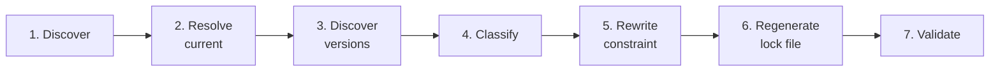

# Upgrade Behavior

## 7. How it works

The pipeline is the same for every provider and every repository.



### 7.1 Provider discovery

The repository is walked for directories containing `.tf` files.
`.git`, `.terraform`, `node_modules` and configured excludes are skipped —
notably `.terraform`, which caches copies of downloaded modules that the
repository does not own.

Each `required_providers` entry is parsed with the HCL library, never regex, so
the tool handles multi-file modules, comments, unusual formatting, the modern
object form, and the pre-0.13 `github = "~> 6.0"` shorthand.

Providers are identified by their **fully qualified source address**
(`registry.terraform.io/integrations/github`), not the local name, because two
modules can bind different sources to the same local name.

A source without a hostname is completed the same way the driving tool
completes it:

| Declared `source` | Terraform (default) | OpenTofu (`--terraform-binary tofu`) |
|---|---|---|
| `aws` (or no `source`) | `registry.terraform.io/hashicorp/aws` | `registry.opentofu.org/hashicorp/aws` |
| `integrations/github` | `registry.terraform.io/integrations/github` | `registry.opentofu.org/integrations/github` |
| `tf.example.com/platform/internal` | unchanged | unchanged |

So under OpenTofu, versions are looked up in the OpenTofu registry, exactly as
`tofu init` would. A fully qualified source always keeps its host, which is how
private registries are addressed with either tool.

A directory referenced by another module's local `source = "./..."` is recorded
as a **child module**. Only root modules own a lock file and can be initialised.

### 7.2 Current version

Two different things are tracked and never conflated:

- **Constraint** — from `required_providers`; what is *acceptable*.
- **Locked version** — from `.terraform.lock.hcl`; what is *actually selected*.

This matters because Terraform repositories typically come in two shapes:

| | Root configuration | Shared module |
|---|---|---|
| Example | `infra-live` | `terraform-aws-vpc` |
| Lock file | Committed | Deliberately absent |
| Constraints | Narrow (`~> 4.65`) | Loose floors (`>= 3.85.0`) |
| "Current" means | The locked version | The **constraint floor** |
| Upgrading means | Move the locked version | Raise the tested floor |

Where a module has a lock file, the locked version is used. Where it does not,
the **lowest version the constraint admits** is used and the output marks it
`(floor)`.

The floor is the right reference point for a shared module: it has selected
nothing, but it does promise its consumers a supported minimum. A module
declaring `>= 3.85.0` while the provider is at 5.6.0 is promising to support
two major versions nobody has tested.

> Using the *highest* allowed version instead would make every shared module
> report "nothing to do", because the highest allowed version is the latest
> version by definition.

If a module has neither a lock file nor a constraint, no comparison is possible
and the provider is reported as unknown rather than guessed at.

### 7.3 Version discovery

Versions come from the registry protocol:

1. Service discovery at `https://<host>/.well-known/terraform.json`
2. `GET <providers.v1>/<namespace>/<type>/versions`

This is why the public Terraform registry, the OpenTofu registry and private
registries (HCP Terraform, Terraform Enterprise, Artifactory, self-hosted
implementations) all work with no extra code; see
[Authentication](../authentication/README.md) for tokens. Results are cached per
run, lookups are concurrent, and `429`/`5xx` responses are retried with backoff.
A failure for one provider is reported on that row and never aborts the others.

### 7.4 Upgrade classification

```
5.1.2 -> 5.1.3   patch
5.1.2 -> 5.2.0   minor
5.1.2 -> 6.0.0   major
```

Prereleases are excluded unless `--include-prerelease` is set, including explicit
`--to` targets. Downgrades are never treated as upgrades. Terraform selects
prereleases only from exact pins (`= 5.0.0-beta.1` or `5.0.0-beta.1`), so an
opted-in prerelease upgrade replaces a supported range with an exact pin.
Unconstrained providers require `--pin-unconstrained` to authorize adding that pin.
Prerelease `--raise-floor` operations on ranges or absent constraints are refused:
an exact prerelease pin cannot preserve their supported-floor semantics. Use an
explicit `--to` target without `--raise-floor` instead.

Upgrades are additionally flagged **breaking** when they cross a major
boundary — or when a `0.x` minor segment changes, since semver permits breaking
changes there and a major-only check would miss it.

Raising a supported floor across one of these boundaries also requires
`--allow-major`, even when the installed version only advances by a patch.

#### Incremental upgrades

`--level` is a **budget**, not a step size. The tool selects the next published
version within that budget:

| Level | Selects |
|---|---|
| `patch` | Next patch within the current major.minor |
| `minor` | Next patch or minor, whichever is published first |
| `major` | Next available patch, minor, or major |

The complete direct and progressive upgrade examples are kept in the
[`provlift upgrade` reference](../cli/README.md#65-provlift-upgrade), so this section explains the
selection rules without duplicating commands.

There are two supported choices:

**Choose one budget.** Use this when you want the next release allowed by one
boundary. `--level minor` permits both patch and minor changes; `--level major`
also permits major changes, which require `--allow-major` when planned:

See the direct-budget examples under [`provlift upgrade`](../cli/README.md#65-provlift-upgrade).

**Progress through the stages.** Use `--exact-level` when patch, minor and
major must be separate reviewable pull requests. The command selects only the
requested level, so a minor upgrade cannot consume a patch stage and a major
upgrade cannot consume a minor stage. It picks the **next published release**
at that level: a patch step from 1.2.31 moves to 1.2.32 before 1.2.33, and an
AWS provider minor step from 5.80.0 moves to 5.81.0 before 5.82.0.

The exact-level restriction also applies when `--to` supplies the target.

See the progressive-stage examples under [`provlift upgrade`](../cli/README.md#65-provlift-upgrade).

The ready-made PR workflow uses this progressive mode automatically. Scheduled
runs try exact patch, then exact minor, then exact major, and raise only the
first stage with work. After that PR is merged, the next run sees the advanced
lock-file version and selects the next stage.

Without `--exact-level`, a major **budget** can choose an intervening patch or
minor release. From 3.100.0 with 3.117.1 and 5.6.0 published, `--level major`
chooses 3.117.1 first.

Repeating an upgrade to the same explicit `--to` target plans zero actions after
the first successful run updates the lock. Automatic next-release selection is
deliberately progressive: another run can select the following release.

`--next-major` skips intervening patch/minor releases and takes the first
published release in the next major series. It must be used with `--level major`:

| Command | From | To |
|---|---|---|
| `--level major` | 3.100.0 | 3.117.1 |
| `--level major --next-major` | 3.100.0 | 4.0.0 |

That gives a reviewable walk, one migration guide per pull request:

The `provlift upgrade` reference contains the complete command sequence and
explains how the target advances after each merged pull request.

A major series that was never published is skipped, so the walk never stalls.
`--next-major` requires `--level major`, cannot be combined with `--to`, and
still requires `--allow-major`.

### 7.5 Constraint updates

The rule is **minimum diff**:

> If the declared constraint already permits the target version, it is left
> completely untouched and only the lock file moves.

Terraform's `init -upgrade` can re-resolve other providers in the same root.
If any unplanned provider moves, or a selected provider moves beyond its planned
target, `provlift` refuses the upgrade and restores the original lock file. Do not
commit a failed upgrade; inspect the diff before proceeding.

A constraint is rewritten only when it would otherwise block the upgrade, and
the rewrite preserves the author's style:

| Existing | Target | Result |
|---|---|---|
| `~> 6.0` | 6.3.1 | *unchanged* |
| `~> 6.0` | 7.0.0 | `~> 7.0` |
| `~> 6` | 7.1.0 | `~> 7` |
| `~> 6.2.0` | 6.4.1 | `~> 6.4.1` |
| `= 3.1.0` | 3.2.0 | `= 3.2.0` |
| `3.1.0` | 3.2.0 | `3.2.0` |
| `>= 3.0, < 4.0` | 5.1.2 | `>= 5.1, < 6.0` |
| `>= 3.0` | 5.0.0 | *unchanged* |
| *(none)* | any | *unchanged* unless `--pin-unconstrained` |

Constraints the tool cannot reason about safely (for example those containing
`!=`, or multiple disjoint ranges) are **refused with a clear message** rather
than silently widened.

Edits are byte-level splices over the exact range of the `version` literal, so
comments, alignment and file ordering survive untouched.

#### Raising a floor

The minimum-diff rule means `>= 3.85.0` is never rewritten, because it already
admits every newer version. For a shared module that is exactly the problem:
the floor is the thing you want to move.

`--raise-floor` rewrites the lower bound even when the existing constraint
would already admit the target:

| Existing | Target | Normal | `--raise-floor` |
|---|---|---|---|
| `>= 3.85.0` | 5.6.0 | *unchanged* | `>= 5.6.0` |
| `>= 3.47.0, < 4.0.0` | 5.6.0 | `>= 5.6, < 6.0` | `>= 5.6.0, < 6.0.0` |
| `~> 1.2.21` | 1.2.34 | `~> 1.2.34` | `~> 1.2.34` |
| *(none)* | 5.6.0 | *unchanged* | `>= 5.6.0` |

This changes the module's contract with its consumers, so it is opt-in and
still obeys `--level` and `--allow-major`.

### 7.6 Lock file handling

**Only Terraform generates `.terraform.lock.hcl` content.** That file records
per-platform checksums that only Terraform can compute. If initialization,
provider locking, or lock verification fails, provlift may restore the original
lock bytes unchanged (or remove a newly created lock when none existed).

Under OpenTofu the same rule holds with `tofu` in place of `terraform`: the
lock file is always produced by the tool that will later read it.

After constraints change, the tool runs:

```
terraform fmt
terraform init -upgrade -input=false -backend=false
terraform providers lock -platform=windows_amd64 -platform=linux_amd64 ...
terraform validate -json
```

`-backend=false` is the default so a routine provider upgrade needs no state
access or cloud credentials. Use `--backend` when you need it.

`terraform providers lock` runs for every configured platform so the resulting
lock file works on Windows workstations, Linux CI runners and macOS laptops
alike — not just the machine that ran the upgrade.

When a **child module's** constraint changes, every root module that
transitively calls it is re-initialised, because each root owns its own lock
file.

#### Which modules should commit a lock file

Terraform reads `.terraform.lock.hcl` only from the **root module** — the
directory `terraform init` runs in. A lock file inside a shared module is
ignored entirely when that module is consumed, so committing one there creates
a file nothing reads and nothing validates. It drifts immediately and implies a
reproducibility guarantee that does not exist.

The rule that follows is precise and mechanically checkable:

> Every **root module** commits a lock file. Shared modules do not.

A root module is any directory you run `terraform apply` in: it has a backend
and owns state.

**Applied to a typical set of repositories**

| Repository type | Examples | Lock file |
|---|---|---|
| Root configurations | `infra-live`, `platform-iac/envs/*`, `networking-prod` | **Required** |
| Shared modules, at the repository root | `terraform-aws-vpc`, `terraform-google-gke`, `terraform-azurerm-aks` | **No** — Terraform ignores it there |
| A bootstrap root inside a module repository, such as `initializer/` | Has a `backend.tf` and deploys state storage | **Required** — it is itself a root configuration |
| `examples/` inside a module repository | `examples/complete` | Optional; commit it if CI runs Terraform there |

A shared module repository therefore may hold *some* lock files — in a
bootstrap root and possibly its examples — but never one at the module root.

**Where reproducibility comes from instead**

A shared module cannot pin versions for its consumers, so its guarantee is
carried by its **version constraints**. That makes constraint consistency the
thing worth enforcing in module repositories, and it is commonly where the real
inconsistency lives:

```
hashicorp/aws
  >= 5.0      ., examples/complete
  >= 5.46.0   initializer
```

One repository, one provider, two different contracts.

`provlift drift` reports both halves of the policy in a single offline command,
so it can gate CI; use the canonical invocation in
[the CLI reference](../cli/README.md#64-provlift-drift).

#### Which modules need `required_providers`

Every module needs one, shared modules included. The lock file and
`required_providers` behave in opposite ways, which is the source of most of
the confusion:

| | Shared module | Root module |
|---|---|---|
| `.terraform.lock.hcl` | Ignored | Authoritative |
| `required_providers` | **Honoured** | Honoured |

Terraform merges the constraints declared by *every* module in the dependency
tree and picks a version satisfying all of them at once. A shared module's
`required_providers` block is therefore its contract with its consumers, and it
is the only lever that module has.

Omitting it is worse than it appears. Terraform falls back to inferring the
provider from resource name prefixes — `aws_s3_bucket` implies
`hashicorp/aws` — and applies **no version constraint at all**, so the
module silently accepts any version ever published.

**Ceilings need care in a shared module.** Because constraints intersect, a
ceiling can block the consumer:

| Module declares | Consumer declares | Result |
|---|---|---|
| `>= 3.85.0` | `~> 4.0` | Resolves to 4.x |
| `>= 3.85.0, < 5.0.0` | `~> 4.0` | Resolves to 4.x |
| `~> 3.0` | `~> 4.0` | **`init` fails** — no version satisfies both |

A module pinned too tightly stops every consumer upgrading until the module is
released again.

Two defensible styles for a shared module:

| Style | Example | Trade-off |
|---|---|---|
| Floor only | `>= 4.11.0` | Never blocks a consumer, but a new major can land silently and break them |
| Floor + major ceiling | `>= 4.11.0, < 5.0.0` | Protects consumers from a surprise major, but blocks them if not updated promptly |

Floor plus a major ceiling is the safer default for a published module, on the
condition that the floor is raised promptly once a new major is adopted —
which is what `provlift upgrade --raise-floor` is for.

Root modules carry no such risk. They own the decision and the lock file does
the real pinning, so a narrow `~> 4.65` is perfectly reasonable there.

### 7.7 Validation split

| Check | Where | Why |
|---|---|---|
| `terraform fmt` | CLI | Tidies the edit it just made |
| `terraform init -upgrade` | CLI | Required to move the lock file |
| `terraform providers lock` | CLI | Multi-platform hashes |
| `terraform validate` | CLI | Catches schema breaks immediately, no credentials needed |
| `terraform plan` | **CI** (opt-in locally) | Needs state, backend access and live credentials, and touches real infrastructure |

### 7.8 Major upgrades

Major and other breaking upgrades require `--allow-major`. Without it the
command refuses and lists exactly what it would have done:

```
Error: refusing to apply 1 major upgrade(s) without --allow-major:
  .: registry.terraform.io/hashicorp/azurerm 3.116.0 -> 5.6.0

Major upgrades may contain breaking changes. Review the provider's upgrade
guide before re-running with --allow-major.
```

The plan output links to each provider's registry documentation. Providers do
not expose upgrade guides through any common API, so the tool links to the
canonical docs page rather than guessing at a URL that may not exist.

---
